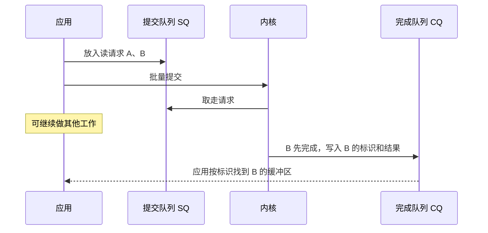
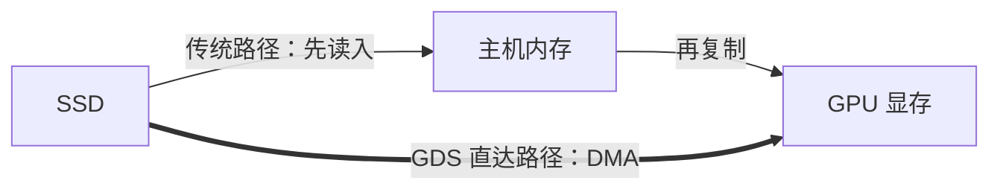
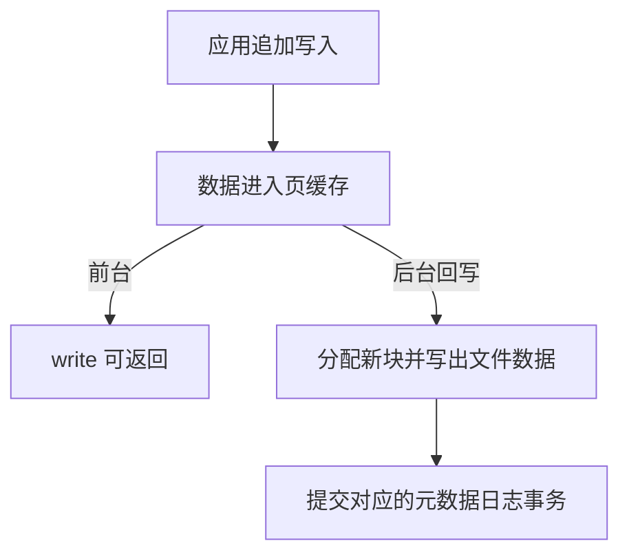
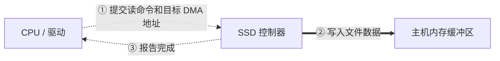

# 存储知识

用简短的模型理解存储系统中常见的技术：它们解决什么问题，如何工作，又适合用在哪里。

## io_uring

**定位**：io_uring 是 Linux 的**异步 I/O 接口**，让应用提交读写请求后继续处理其他工作，并通过队列收取结果。[^uring]

**痛点**：**线程等待**——普通阻塞读写会让线程等待；**并发开销**——多线程需要调度与同步，大量小 I/O 逐个进入内核也可能产生明显开销；**就绪不等于完成**——`epoll` 主要报告事件是否就绪，应用通常还需要发起读写，普通文件就绪也不意味着数据已从磁盘读出。[^poll]

**核心抽象**：应用和内核通过**共享的两个环形队列**交换信息：**提交队列（SQ）**存放待执行的请求，**完成队列（CQ）**存放结果。每个请求可以附带标识，方便应用在请求乱序完成时找到对应上下文。[^uring]

**一次读取**：应用可以一次提交多个读请求。内核把数据写入各自的缓冲区，完成队列只返回请求标识和结果。[^uring][^enter]

**取舍**：**性能不保证**——异步不一定更快，也不意味着零拷贝或完全没有系统调用；**管理更复杂**——需要处理请求状态、缓冲区生命周期和乱序完成；**依赖环境**——收益取决于负载、设备和内核等条件，部署环境也可能限制其使用。[^sysctl]

**优势**：异步执行、批量提交、减少线程等待。

**场景**：适合评估**并发文件 I/O 较多**，且系统调用或线程协调开销成为瓶颈的工作负载。对于偶发、串行的文件读写，或现有方案已满足要求的程序，普通阻塞 I/O 往往更简单。

## GDS

**定位**：GPUDirect Storage（GDS）是 NVIDIA 的**GPU 直达存储技术**，让存储与 GPU 显存之间的数据传输可以绕过 CPU 内存中的中转缓冲区。[^gds]

**痛点**：**多次搬运**——传统路径通常先把数据读入主机内存，再复制到 GPU 显存；**资源竞争**——中转可能增加延迟，并占用主机内存带宽。[^gds]

**核心抽象**：**存储端**提供数据，**GPU 显存**是读写目标或来源，**直接内存访问（DMA）**负责数据搬运；应用通过 **cuFile 接口**发起 I/O。CPU 和驱动仍参与请求的设置与管理。[^gds][^gds-design]

**一次读取**：应用通过 cuFile 指定文件和目标显存，完成后 GPU 即可使用数据。下图对比同一批数据从 SSD 到显存的两条路径。[^gds]

**取舍**：**依赖环境**——能否使用直达路径取决于硬件拓扑、文件系统、驱动和配置；**可能回退**——某些条件下会使用兼容路径或中间缓冲区；**收益不保证**——直达传输不代表 CPU 完全不参与，也不保证每次 I/O 都更快。[^gds][^gds-design]

**优势**：减少主机内存中转、降低 CPU 负担、改善传输效率。

**场景**：适合评估**存储与 GPU 之间数据量大、传输频繁**的工作负载，例如加载训练数据或从 SSD 恢复 GPU 缓存。数据量小、传输并非瓶颈，或环境不支持直达路径时，常规路径可能更简单。

## ext4

**定位**：ext4 是 Linux 的**本地文件系统**，负责在块设备上组织文件、目录及其元数据，并将文件读写转换为对底层存储块的操作。[^ext4-design]

**痛点**：**空间管理**——文件大小不断变化，需要记录文件数据位于哪些存储块；**访问效率**——频繁分配零散块会增加元数据开销，并可能降低访问局部性；**故障恢复**——系统崩溃可能打断文件和目录的更新，使元数据处于不一致状态。[^ext4-design][^ext4-journal]

**核心抽象**：**inode** 记录文件属性及数据位置，目录将文件名关联到 inode；**extent** 用连续块范围描述文件数据位置；**块组**组织磁盘空间，帮助分配时利用局部性；**日志（journal）**记录需要保护的更新，供崩溃后恢复。[^ext4-design][^ext4-journal]

**一次追加写**：默认 `data=ordered` 模式下，缓冲写入可以在数据进入页缓存后返回。以需要新分配数据块的追加写为例，下面两条线标出了应用能继续执行的时刻，以及后台写回的顺序。[^ext4-alloc][^ext4-options]

**取舍**：**一致性不等于持久性**——日志主要保护文件系统元数据的一致性，并不保证应用刚写入的数据已经持久保存；应用有持久性要求时需正确使用 `fsync` 等接口。**分配与恢复有代价**——延迟分配、日志和维护元数据会带来额外复杂度与开销；实际表现取决于负载、挂载选项和设备。[^ext4-options][^ext4-fsync]

**优势**：紧凑的块映射、分配局部性、元数据崩溃恢复。

**场景**：适合 Linux 主机上的通用本地文件存储，例如系统盘和应用数据盘；对特定负载，应结合设备、可靠性要求和实际测试选择文件系统及配置。

## DMA

**定位**：直接内存访问（Direct Memory Access，DMA）是一种**硬件数据传输机制**。以读盘为例，CPU 指定读什么、放在哪里，SSD 控制器把数据写入目标内存。[^dma]

**痛点**：在程序控制 I/O（PIO）中，CPU 反复读取设备的数据寄存器，再把数据写入内存。传输的数据越多，CPU 花在搬运上的指令就越多。

**核心抽象**：**驱动**准备请求，**设备控制器**执行搬运，**缓冲区**接收数据。驱动把缓冲区映射成设备能使用的 **DMA 地址**，同一块内存在 CPU 和设备侧可以有不同的地址。[^dma]

**一次读取**：以 NVMe SSD 读入主机内存为例。虚线表示命令和完成状态，粗实线表示文件数据。

**取舍**：映射与同步有开销。传输期间必须保持缓冲区有效，设备写完并完成必要的同步后，CPU 才能安全读取或复用它。DMA 只负责这一段搬运，后续路径仍可能复制数据。[^dma]

**优势**：搬运卸载、释放 CPU、计算与传输重叠。

**场景**：SSD 读写数据块、网卡收发数据包都适合 DMA。普通应用读文件时，底层驱动通常已处理 DMA；设备驱动中偶尔读一个状态寄存器，CPU 直接访问更简单。

## 参考文献

[^dma]: David S. Miller、Richard Henderson. 《Dynamic DMA mapping Guide》. [Linux 内核文档](https://docs.kernel.org/core-api/dma-api-howto.html)。

[^uring]: Linux man-pages. 《io_uring(7)》. [原文](https://man7.org/linux/man-pages/man7/io_uring.7.html)。

[^poll]: Linux man-pages. 《poll(2)》. [原文](https://man7.org/linux/man-pages/man2/poll.2.html)。

[^enter]: Linux man-pages. 《io_uring_enter(2)》. [原文](https://man7.org/linux/man-pages/man2/io_uring_enter.2.html)。

[^setup]: Linux man-pages. 《io_uring_setup(2)》. [原文](https://man7.org/linux/man-pages/man2/io_uring_setup.2.html)。

[^sysctl]: Linux kernel documentation. 《Documentation for /proc/sys/kernel/》. [io_uring_disabled](https://www.kernel.org/doc/html/latest/admin-guide/sysctl/kernel.html#io-uring-disabled)。

[^gds]: NVIDIA. 《GPUDirect Storage Overview Guide》. [原文](https://docs.nvidia.com/gpudirect-storage/overview-guide/)。

[^gds-design]: NVIDIA. 《GPUDirect Storage Design Guide》. [原文](https://docs.nvidia.com/gpudirect-storage/design-guide/)。

[^ext4-design]: Linux kernel documentation. 《High Level Design》. [原文](https://docs.kernel.org/6.15/filesystems/ext4/overview.html)。

[^ext4-alloc]: Linux kernel documentation. 《Block and Inode Allocation Policy》. [原文](https://docs.kernel.org/6.16/filesystems/ext4/allocators.html)。

[^ext4-journal]: Linux kernel documentation. 《Global Structures》. [原文](https://docs.kernel.org/6.15/filesystems/ext4/globals.html)。

[^ext4-options]: Linux kernel documentation. 《ext4 General Information》. [原文](https://docs.kernel.org/admin-guide/ext4.html)。

[^ext4-fsync]: Linux man-pages. 《fsync(2)》. [原文](https://man7.org/linux/man-pages/man2/fsync.2.html)。
