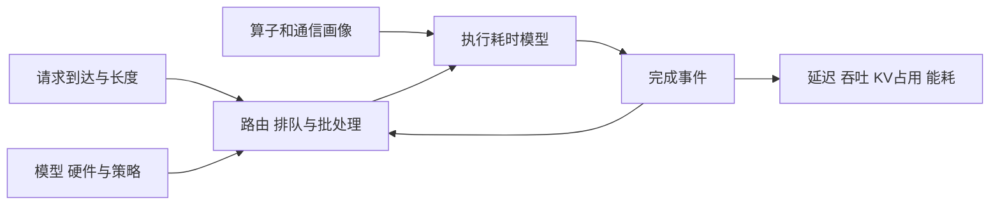

# 大模型推理模拟器

大模型推理模拟器用工作负载、服务策略和硬件性能模型，预测请求延迟、吞吐、显存或能耗。它帮助研究者在真实 GPU 集群上运行全部组合之前，筛选值得测量的候选，或比较现实中暂时无法部署的硬件。Vidur 是本专题的起点。[^vidur]

## 纳入范围

核心论文需要直接构建或使用推理性能模拟器研究部署，并已有全文笔记。训练和推理统一模拟器仅讨论与推理相关的部分；单纯使用模拟器评估服务策略的论文作为邻接案例。模拟器不会实际生成回答，本专题也不讨论用语言模型模拟人的行为。各论文的版本、阅读状态和数字边界见对应笔记。

## 核心论文

- [[Vidur-MLSys24]]（2024）— 以算子画像和离散事件调度模拟请求，结合基准与配置搜索。
- [[LLMServingSim2-ISPASS26]]（2026）— 联合建模异构设备、P/D 分离、缓存、网络和功率；全文为作者预印本版本。
- [[Charon-MLSys26]]（2026）— 以算子图、并行变换和多种性能后端统一模拟训练与推理。
- [[MetaInferenceConfig-MLSys26]]（2026）— 用算子画像和轻量模拟搜索工业推理部署配置，分析并行、MoE 与硬件选择。

## 阅读路线

建议先读 Vidur，理解动态服务模拟为什么需要画像、调度和状态；再读 LLMServingSim 2.0 看 P/D 及异构资源；随后读 Charon 看图级执行与通信，最后读 Meta 的部署搜索案例。[[SarathiServe-OSDI24]] 使用 Vidur 选择离线预算，[[DistServe-OSDI24]] 和 [[SplitScaling-IJCAI26]] 也分别使用模拟研究部署或扩缩容，但它们的主要贡献是服务系统，不计入本专题核心成员。

## 模拟器到底模拟什么

真实推理服务会接收请求、排队、安排 prefill 和 decode、访问或迁移 KV cache，再返回结果。模拟器不执行完整模型生成，而是用预测的耗时和状态变化推进这条路径。它的输入是问题的一部分：没有请求到达时间、输入输出长度、模型、硬件、拓扑和策略，输出就缺少解释条件。



例如，一个 decode 请求正在运行时新请求到达。调度器决定它何时进入 prefill、是否与 decode 同批；执行时间模型按本轮输入形状估计耗时。模拟时钟推进到完成事件，队列和 KV 状态更新，再形成下一轮批次。**预测误差会改变下一次调度**：迭代若被估得过快，模拟器可能少算排队，也可能形成与真实系统不同的批次。[[Vidur-MLSys24]] 用分层调度和算子画像表达这条反馈。

## 四篇论文的区别

| 论文 | 主要问题与表示 | 性能来源 | 适合先问什么 | 不能直接推断什么 |
|---|---|---|---|---|
| [[Vidur-MLSys24]] | 请求、批次、KV 容量与分层事件调度 | 算子实测、随机森林预测、通信画像 | 一组模型、流量与调度配置的延迟和容量如何变化？ | 2024 年论文未验证所有新型 P/D、MoE 或长上下文实现 |
| [[LLMServingSim2-ISPASS26]] | 服务组、设备、执行图、缓存与拓扑的运行反馈 | 算子画像或外部设备模型，结合网络及功率模型 | 分离部署、异构设备和多级缓存怎样相互影响？ | 每种异构组合、P/D 切换策略和尾延迟都已被实测验证 |
| [[Charon-MLSys26]] | 从模型提取算子图，添加并行、依赖和通信 | 画像、随机森林预测、解析模型及竞争估计 | 并行切分、算子重排、通信重叠如何影响执行？ | 训练集群结果等同于线上推理排队精度 |
| [[MetaInferenceConfig-MLSys26]] | 对算子、并行配置和运行时组合进行轻量估计及搜索 | 不同形状、硬件与通信的实测画像和插值 | 在给定约束下，哪些部署候选值得实机测试？ | 模拟图表、假设硬件成本和真实生产结果是同一证据 |

这张表按论文所述设计与实验组织；它不是对最新代码功能的完整盘点。精度数字来自不同硬件、负载、指标和校验方式，不能直接按摘要的误差排序。[^vidur][^servingsim][^charon]

## 如何建立一个可信的模拟

### 1. 先确定要回答的问题

“H100 比 A100 快多少”“给 P 和 D 各分几张卡”“不同前缀命中率下哪种路由更好”是不同问题。前者关注单实例性能和成本；第二个必须表示阶段速率、P/D 排队、KV 交接和网络；第三个还需要缓存命中、驱逐与请求相似性。只建模平均 token 速率，无法回答这些问题中的全部部分。

明确结果的单位：TTFT 是首 token 延迟；TBT 或 ITL 是相邻 token 间隔；TPOT 通常是一次请求的平均每输出 token 时间。goodput 可能按满足特定 SLO 的请求数定义，也可能按另一种有效吞吐定义，必须看论文的实际公式。平均值、P95、P99 和逐请求双目标达成率不能互换。[[PD-Serving]] 汇总了阶段分离相关的指标差异。

### 2. 画像和执行模型要匹配目标系统

记录 GPU 型号、驱动、推理引擎和 kernel 版本、精度、并行策略、拓扑和算子形状。[[Vidur-MLSys24]] 将 token 级、attention 和通信算子分开画像；[[Charon-MLSys26]] 允许画像、学习预测与解析模型按算子选择。两种设计都依赖输入覆盖：未见过的 batch、上下文或新 kernel 需要检验外推能力。

要特别区分**可以在 CPU 上运行模拟**与**完全不需要真实硬件数据**。Vidur 的模拟运行可以不占目标 GPU，但新模型或硬件画像本身可能需要真实 GPU；Charon 的画像后端同样如此。[^vidur][^charon]

### 3. 工作负载和状态转移要足够真实

至少记录到达时间、输入长度、输出长度、请求之间的前缀复用关系，以及是否有多轮依赖。把每个请求替换成平均长度会丢失长尾；用泊松到达替换真实时间戳则会改变突发结构。一个轨迹可能只有真实长度，而到达时序仍是合成的：Vidur 和 LLMServingSim 2.0 的论文实验就有这种设置。[^vidur][^servingsim]

状态需要覆盖待研究策略：队列、在途批次、KV 占用、缓存命中与驱逐、阶段连接、链路带宽。若问题涉及动态 P/D 配比，模型加载、实例就绪、排空请求、KV 迁移及切换期间的容量变化也需要表示；不能把理论上瞬时切换的收益当成真实收益。[[FluidPD-arXiv26]] 和 [[SplitScaling-IJCAI26]] 提供了区分角色切换与扩缩容的背景。

### 4. 用实机验证指标和决策

同一轨迹下，先核对单轮算子和通信时间，再核对 batch、队列及 KV 随时间变化，最后比较 TTFT、TBT/TPOT、吞吐和 SLO 达成率。离线静态执行精度不等于在线排队精度；聚合总吞吐精度也不等于每个时刻或每个请求的尾部精度。

在低载、中载、接近饱和、突发四类负载中分别验证，并更换未参与画像的形状或轨迹。[[Vidur-MLSys24]] 附录显示接近容量时误差可以放大；[[LLMServingSim2-ISPASS26]] 的时间序列误差也高于整段聚合误差。这两例说明平均误差不能覆盖所有行为。

最终还要核对**决策**：模拟器是否选对最佳配置？它判断满足 SLO 的配置，在实机上是否真的满足？当两个配置差距很小，哪怕各自误差看起来不大，排序也可能颠倒。应保留若干接近前沿的候选进行实测，并报告误差和不确定性。

## 从 Vidur 动手的入口

截至本专题整理时，[Vidur 官方仓库说明](https://github.com/microsoft/vidur)给出 Python 3.10 的环境依赖，以及从仓库根目录运行的入口：

```text
python -m vidur.main -h
python -m vidur.main
```

先看帮助和仓库 README 的完整示例，确认所选模型、GPU、拓扑与预置画像是否匹配，再固定随机种子和工作负载逐项改变配置。README 的示例使用 Llama-3-8B、单张 A100、请求长度轨迹、泊松到达及 Sarathi 调度器；这是示例配置，不代表已在本工作区运行。README 还指出部分较新的缓存和路由功能位于 `canary` 分支，使用时应记下分支和提交版本。[^repo]

输出包括指标和执行轨迹；官方说明本地结果保存在 `simulator_output/<TIMESTAMP>`，并可用浏览器的 tracing 页面打开轨迹。默认可能使用 Weights & Biases，README 提供关闭方法。以上是仓库文档的运行入口，本专题没有安装依赖或做运行验证，也不保证不同操作系统上的环境配置相同。[^repo]

## 用模拟器研究 P/D 数量分配

假设手头有 8 张同型号 GPU，想比较 1P:7D、2P:6D、3P:5D 等组合。先说明一个 P 或 D 实例是否跨多张卡，以及各阶段 TP、批量和模型副本；实例数不一定等于 GPU 数。对每个候选输入同一组到达轨迹、输入输出长度与前缀命中情况，记录：

1. P、D 队列长度与阶段完成速率，识别持续积压的阶段。
2. KV 交接量、有效带宽和网络等待，区分已复用的旧 KV 与新生成 KV。
3. TTFT、逐 token 延迟、双 SLO 达成率及单位 GPU 成本；对负载上升和突发分别比较。
4. 若允许配比变化，再计入角色切换、实例启动、预热和请求排空时间。

这是一套实验设计，不是对任一模拟器已实现所有能力的承诺。[[LLMServingSim2-ISPASS26]] 描述了 P/D 服务组和交接建模，可作为起点；[[DistServe-OSDI24]]、[[SplitScaling-IJCAI26]] 分别展示面向配置规划和动态扩缩容的不同模拟用途。能否直接运行某种策略取决于代码版本及其配置接口。

## 近期候选与工具

以下是已核对论文页或项目入口、尚未完成本地全文笔记的候选，不计入核心论文数。能力描述仅代表来源所述，不当作独立验证。

- [LLMServingSim 初代（IISWC 2024）](https://arxiv.org/abs/2408.05499)：关注动态迭代与硬件—软件协同模拟；与已纳入的 2.0 版本分别阅读。
- [TokenSim（2025）](https://arxiv.org/abs/2503.08415)：研究推理系统的软硬件探索；LLMServingSim 2.0 将其列为对照。
- [Frontier（2026 预印本）](https://arxiv.org/abs/2605.21312)：面向更完整的推理服务模拟；[项目仓库](https://github.com/NetX-lab/Frontier)说明其基于 Vidur，版本能力需核对。
- [BLIS（2026 预印本）](https://arxiv.org/abs/2610.14255)：面向部署规划的 CPU 离散事件模拟；论文自述已被 SIGMETRICS 2027 接收，采用全局拟合的延迟模型和请求级队列模拟。其论文版本明确不建模跨池 KV 传输的 P/D 分离，不能直接用于 P/D 实例比例评估。[项目仓库](https://github.com/inference-sim/inference-sim)与论文需要按同一版本核验。已取得本地 PDF，尚未完成全文解析和论文笔记。
- [APEX+ 项目](https://github.com/microsoft/apex_plus)：微软公开的推理服务模拟器；这里暂作代码入口，不将其当前功能视为已核实论文结论。

## 值得继续研究的问题

- **校准可迁移性**：同一 GPU 更换推理框架、attention kernel 或模型后，需要多少新画像才能恢复可信的排序？
- **阈值附近的风险**：在 P99 SLO 附近，如何用误差区间而不是单一预测值决定是否接受一个部署配置？
- **缓存与流量反馈**：prefix 命中率、路由倾斜和排队是否互相放大，模拟模型是否保留真实相关性？
- **阶段弹性成本**：对 P/D 分配加入 KV 迁移、模型加载和切换期间的丢失容量后，动态调整需要多长时间才能收回成本？
- **画像成本**：把算子测量、模拟运行、搜索和真实候选复测放在同一预算内比较，而不仅统计一次模拟的 CPU 时间。

[^vidur]: [Vidur 论文](https://proceedings.mlsys.org/paper_files/paper/2024/file/b74a8de47d2b3c928360e0a011f48351-Paper-Conference.pdf)，MLSys 2024。
[^servingsim]: [LLMServingSim 2.0 论文，arXiv v2](https://arxiv.org/abs/2602.23036v2)。
[^charon]: [Charon 会议论文页](https://proceedings.mlsys.org/paper_files/paper/2026/hash/dbc8ce0fdfcd55172d73fb05dbae07fc-Abstract-Conference.html)，MLSys 2026。
[^repo]: [Vidur 官方 README](https://github.com/microsoft/vidur/blob/main/README.md)，2026-10-29 查看。
